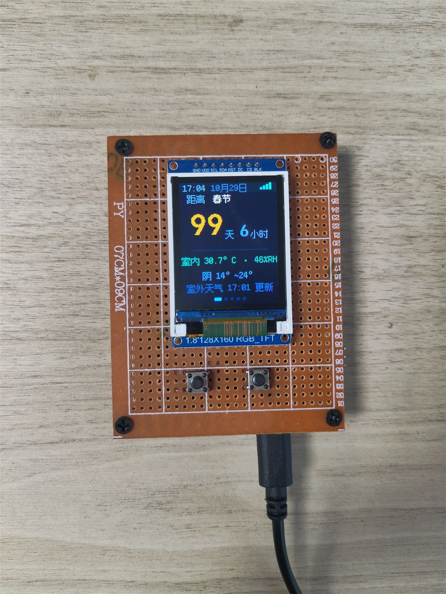
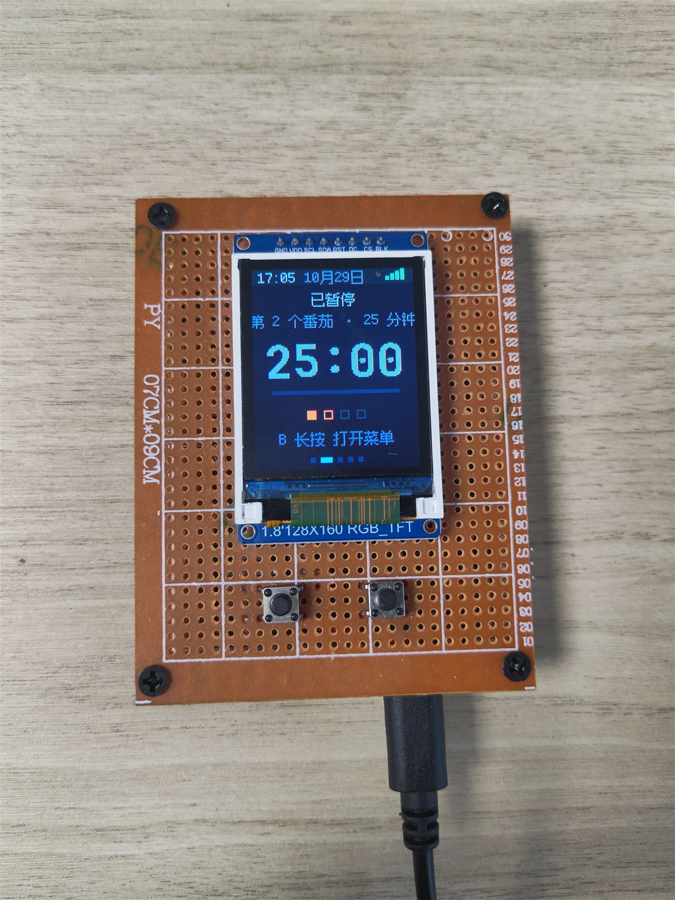
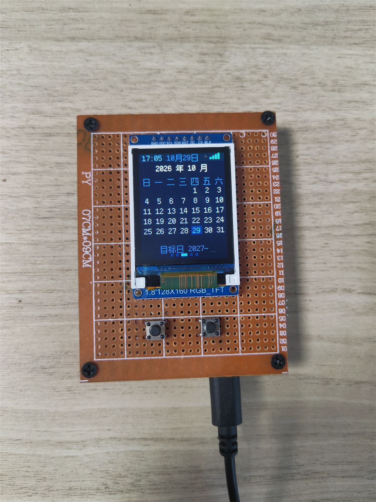
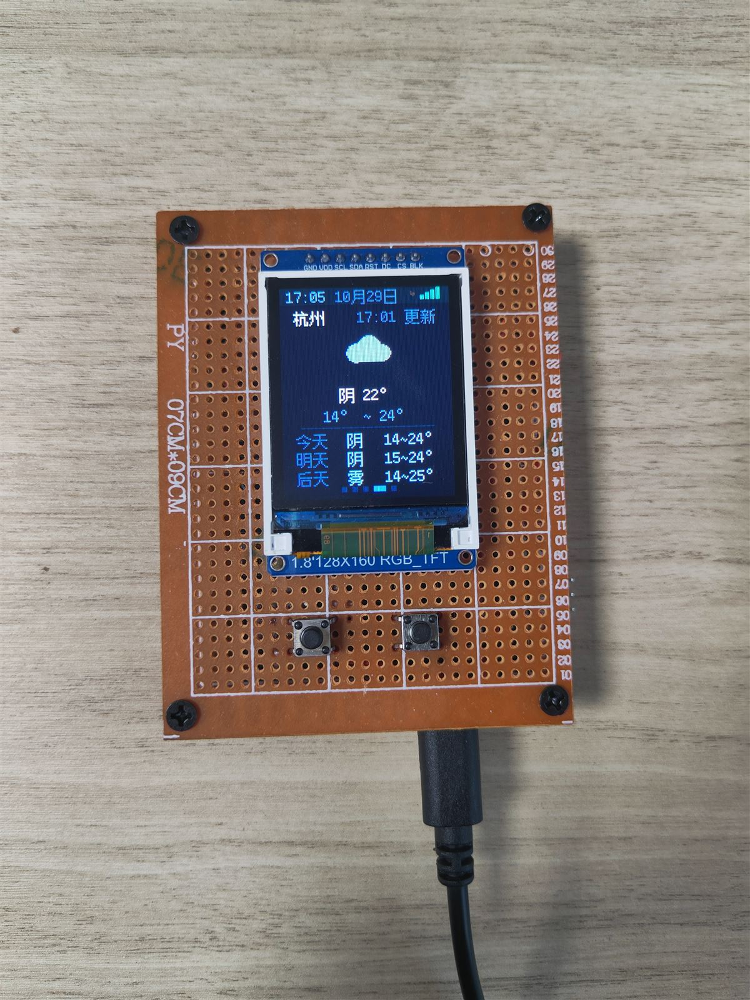
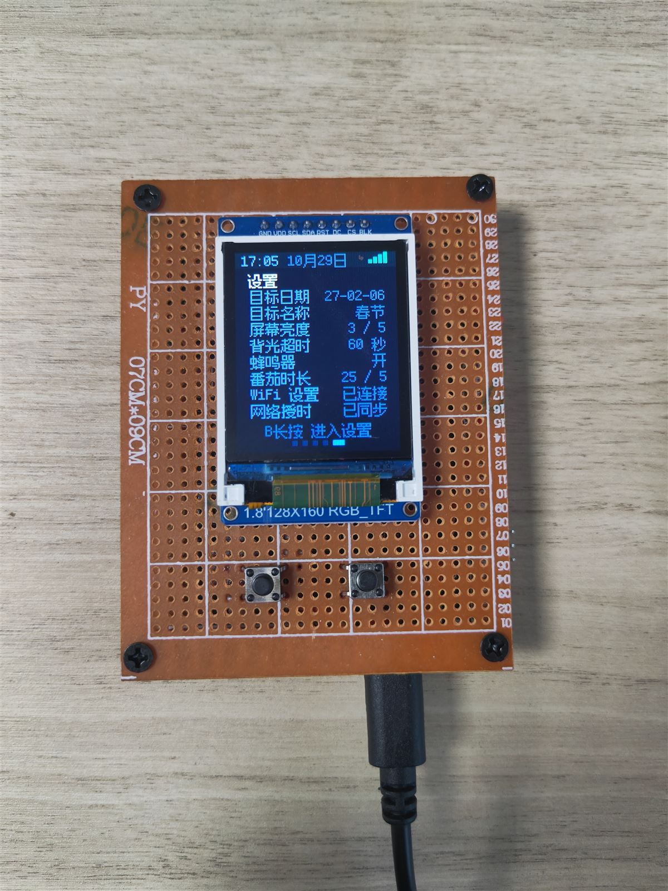
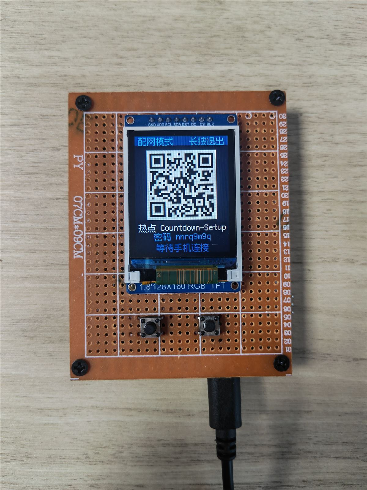
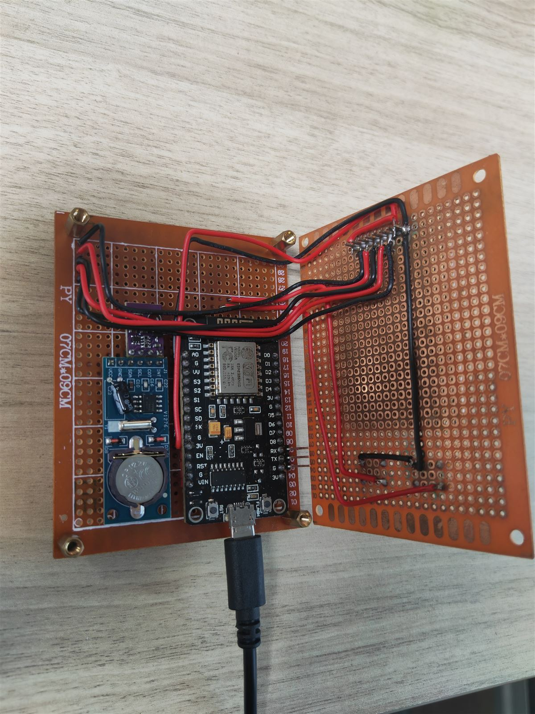
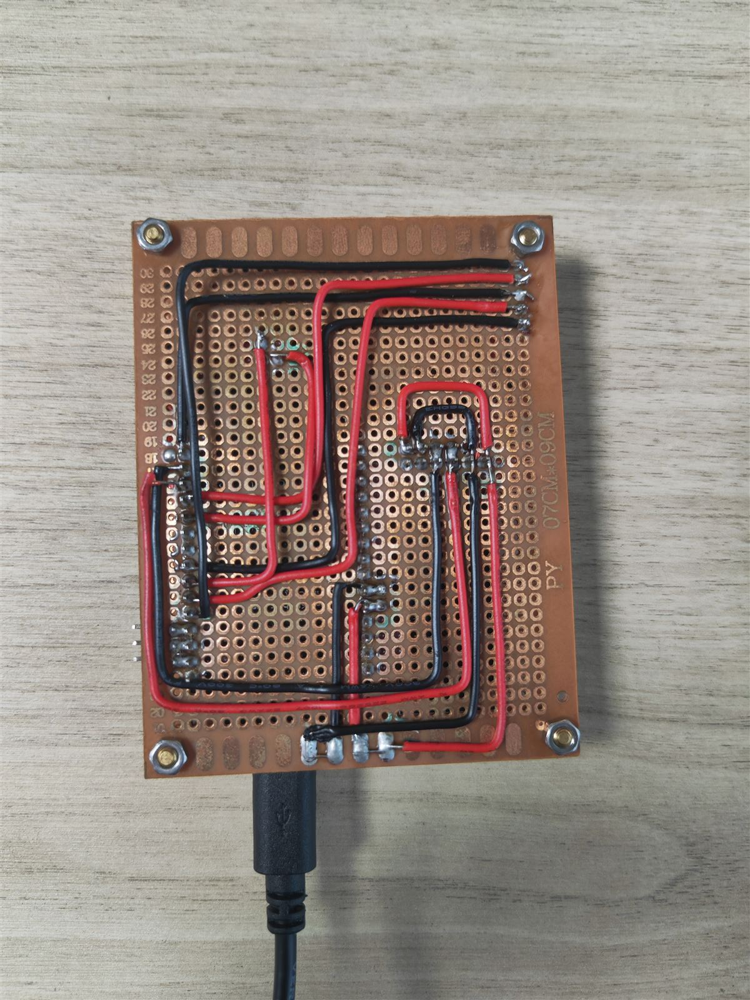
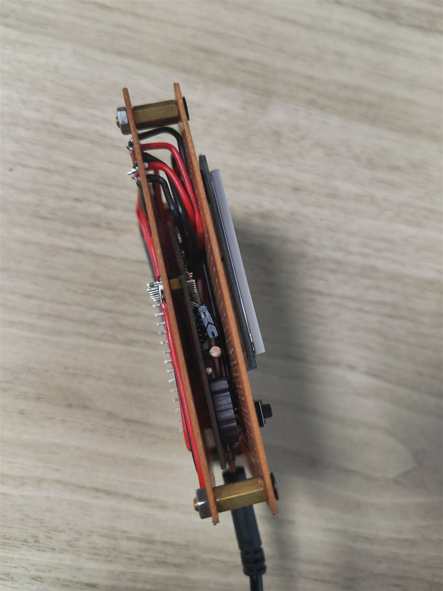

# 双层 ESP8266 倒数日 · ESP8266 Countdown Desk Clock

> 一台自己焊的桌面倒数日：1.8" 彩色屏、双按键、温湿度、RTC 走时、WiFi 配网、NTP 授时与实时天气。
> 双层万用板结构——前面板是屏幕与按键，后面板是主控、RTC 与全部走线。

<p align="center">
  
</p>

<p align="center"><sub>实物拍摄：距离春节 99 天 6 小时 · 室内 30.7°C / 46%RH · 杭州 阴 14~24°</sub></p>

**固件版本 v0.6.1** · 硬件已实机验证（配网 / 授时 / 天气全部闭环）

> **关于制作方式**
>
> 硬件全部手工完成：双层万用洞洞板、面板开孔、飞线走线、逐个焊点。
> 代码由 [DeepSeek-V4.1-Flash](https://www.deepseek.com/) 生成，整个过程是典型的 **Vibe Coding** —— 我提需求、定硬件约束、在真机上验证，AI 出代码，跑不通就继续对话改。

## 界面一览

<table>
  <tr>
    <td align="center"><br><sub>倒数日</sub></td>
    <td align="center"><br><sub>番茄钟</sub></td>
    <td align="center"><br><sub>日历</sub></td>
  </tr>
  <tr>
    <td align="center"><br><sub>天气</sub></td>
    <td align="center"><br><sub>设置</sub></td>
    <td align="center"><br><sub>WiFi 配网（扫码）</sub></td>
  </tr>
</table>

## 功能

- **倒数日**：距离目标日期还剩多少天 / 小时（目标日期可改，存 EEPROM）
- **番茄钟**：25 分钟倒计时，时长 5~90 分钟可调，结束时屏幕提示（无蜂鸣器）
- **日历**：月视图，今天 / 目标日高亮，可把任意一天设为倒数目标
- **天气**：Open-Meteo 实时天气 + 未来三天预报，30 个内置城市（默认杭州），30 分钟自动刷新
- **设置**：目标日期、目标名称、屏幕亮度\*、背光超时\*、蜂鸣器\*、番茄时长、WiFi 配网、网络授时
- **双按键交互**：短按翻页 / 加减，长按返回 / 确认；操作态状态栏变蓝提示
- **WiFi 配网**：手机扫码连热点 → 自动弹出配置页 → 选 WiFi 输密码
- **自动授时**：联网后 NTP 校时，每 24 小时写一次 RTC；RTC 掉电或首次上电自动用编译时间兜底
- **真实信号图标**：右上角 4 格按实际 RSSI 显示
- **中文界面**：内置 12px 点阵（Fusion Pixel 等宽，OFL-1.1，约 750 字形），数字用 JetBrains Mono Bold 的 36 / 28 / 20px 三档

\* 屏幕亮度、背光超时、蜂鸣器为**预留设置项**：当前硬件 BLK 直接接 3.3V（常亮），且未安装蜂鸣器。

## 硬件

| 部件 | 型号 / 规格 | 说明 |
|---|---|---|
| 主控 | ESP8266 开发板（ESP-12F / ESP8266MOD） | 4MB Flash |
| 屏幕 | 1.8" TFT **ST7735S** 128×160，SPI，8 针 | IPS 版观感更好 |
| 温湿度 | **AHT30**（I2C，0x38） | ±0.5°C / ±3%RH |
| RTC | **PCF8563T** 模块（I2C，0x51） | 带 CR2032 电池座 |
| 按键 | 6×6×5 四脚轻触开关 ×2 | 内部上拉，无外部元件 |
| 结构 | 约 7×9 cm 万用板 ×2、铜柱、M3 螺丝 | 双层堆叠 |

完整清单见 [docs/配件表.md](docs/配件表.md)。

> 选屏备忘：1.8" 128×160 约 114 PPI，12px 中文一行约 10 字；**不要选 OLED** —— 倒数日长期显示同一画面会永久烧屏，LCD 没有这个约束。

## 接线

### TFT（8 针）

| 屏引脚 | ESP8266 |
|---|---|
| VCC | 3.3V |
| GND | GND |
| SCL（= SCK） | **D5 / GPIO14** |
| SDA（= MOSI） | **D7 / GPIO13** |
| RES | **D0 / GPIO16** |
| DC | **D3 / GPIO0** |
| CS | **D8 / GPIO15** |
| BLK | 3.3V（常亮） |

### I2C（AHT30 与 PCF8563 共用总线）

| 信号 | ESP8266 |
|---|---|
| SDA | **D2 / GPIO4** |
| SCL | **D1 / GPIO5** |
| VCC | 3.3V |
| GND | GND |

PCF8563 的 `INT`、`CLKOUT` 悬空不接。

### 按键

| 按键 | ESP8266 | 另一端 |
|---|---|---|
| A（左） | **D4 / GPIO2** | GND |
| B（右） | **D6 / GPIO12** | GND |

四脚开关必须**跨侧取脚**（同侧两脚内部常通，接同侧等于短路）。

## 双层结构

<table>
  <tr>
    <td align="center"><br><sub>打开：屏幕层 + 主控层</sub></td>
    <td align="center"><br><sub>背面：红黑电源 / 信号走线</sub></td>
    <td align="center"><br><sub>侧面：铜柱堆叠</sub></td>
  </tr>
</table>

- **前面板**：1.8" 屏 + 两个 6×6 轻触开关，边缘用白色丝印标出引脚定义
- **后面板**：ESP8266 开发板、PCF8563 模块（CR2032 电池座）、AHT30、全部飞线
- 两层之间用**铜柱 + M3 螺丝**固定，屏幕排线从中间穿过
- 背面走线全部用红（3.3V）/ 黑（GND）区分，信号线单独走内圈

## 编译与烧录

### 1. 开发板设置

- Arduino IDE 2.x
- ESP8266 core **3.1.2**
- 开发板：`NodeMCU 1.0 (ESP-12E Module)`（或 `Generic ESP8266 Module`）
- Flash Size：**4MB (FS:2MB OTA:~1019KB)**
- CPU Frequency：80 MHz
- Upload Speed：115200

### 2. 依赖库

| 库 | 版本 | 来源 |
|---|---|---|
| **TFT_eSPI** | 2.5.43 | Arduino 库管理器（Bodmer） |
| **QRCode** | latest | 库管理器搜索 `QRCode`（Richard Moore） |

### 3. TFT_eSPI 配置（关键，别跳过）

本项目的屏幕实测**只吃 `ST7735_REDTAB` 初始化序列**，且颜色顺序必须是 **RGB**（不是 BGR）。

1. 把 `hardware/Setup_Countdown_ESP8266_ST7735.h` 复制到  
   `Arduino/libraries/TFT_eSPI/User_Setups/`
2. 打开 `Arduino/libraries/TFT_eSPI/User_Setup_Select.h`，注释掉默认的
   `#include <User_Setup.h>`，改为：

```cpp
#include <User_Setups/Setup_Countdown_ESP8266_ST7735.h>
```

### 4. 烧录

打开 `firmware/Countdown/Countdown.ino`，选择开发板与串口，上传。串口监视器 **115200**。

> `firmware/Countdown/` 是 Arduino sketch 目录（文件夹名必须与 `.ino` 同名），不要拆散里面的文件。

## 使用

| 手势 | 浏览态 | 操作态 |
|---|---|---|
| **A 短按** | 上一页 / 减 | 减 |
| **B 短按** | 下一页 / 加 | 加 |
| **A 长按** | 回主页 | 取消并退出 |
| **B 长按** | 进入操作态 | 确认 / 保存 |

- 页面环：**倒数日 → 番茄钟 → 日历 → 天气 → 设置**
- 浏览态 30 秒无操作自动回主页
- **WiFi 配网**：设置页 → `WiFi 设置` → **B 长按**。屏幕显示二维码与随机密码，手机扫码连接热点 `Countdown-Setup`，自动弹出配置页；3 分钟无人连接自动退出
- **网络授时**：设置页 → `网络授时` → **B 长按**手动立即授时
- **天气**：天气页 → **B 长按** → 立即刷新 / 切换城市

## 资源占用（Arduino IDE 编译报告）

| 项目 | 占用 | 说明 |
|---|---|---|
| RAM（全局/静态） | 38,484 / 80,192 = **47%** | 剩余给堆 + 栈 |
| IRAM | 61,451 / 65,536 = **93%** | 最紧的一项；可用 IRAM 剩约 4 KB |
| Flash | 361,792 / 1,048,576 = **34%** | 字库约 114 KB（PROGMEM） |

> 以后加功能时注意：不要引入大段 `IRAM_ATTR` 代码或 TLS（IRAM 余量只有约 4 KB）。

## 已知坑（都是实际踩过的）

1. **GPIO12 是硬件 SPI 的 MISO**：`tft.init()` 内部的 `spi.begin()` 会把 GPIO12 重配为 SPECIAL 并清掉内部上拉。按键的 `pinMode(..., INPUT_PULLUP)` 必须放在 `tft.init()` **之后**，否则按键永远读不到（表现为"没反应"或"一直按着"）。本仓库已处理。
2. **ST7735 初始化序列**：1.8" 模块常见两套初始化，本模块 `INITB` 白屏，必须用 `REDTAB`。
3. **红蓝互换**：`REDTAB` 默认按 BGR 发色，需 `#define TFT_RGB_ORDER TFT_RGB`。
4. **屏幕"红线"其实是保护膜**：先撕膜再排查偏移。
5. **上传需要 RX**：ESP8266 烧录靠 UART 握手；板载 CH340 损坏时用外置 CP2102（**3.3V 电平**，TX→RX、RX→TX、GND 共地）。
6. **GPIO6~11 绝对不可用**（内部连接 SPI Flash）；GPIO0 / GPIO2 上电必须为高、GPIO15 必须为低。
7. **不要在 AP+STA 模式下用同步版 `WiFi.scanNetworks()`**：核心库在手机已连热点时可能永久挂起，且 `_scanStarted` 卡死后无法复位。本仓库使用非阻塞状态机 + 缓存 + SDK 兜底。
8. **手写 HTTP 请求缓冲区要留足**：Open-Meteo 请求实测 242 字节，缓冲区不足会截掉结尾的 `\r\n\r\n`，服务器会一直等待导致超时（`http=0 hdr=0 len=0`）。
9. **中文字库**：`font_cn12.h` 由 `tools/gen_font.ps1` 使用 **Fusion Pixel 12px（等宽）** + **JetBrains Mono Bold** 渲染生成，两者均为 **SIL OFL 1.1** 开源字体。修改界面文案后双击 `tools/gen_font.cmd` 重新生成即可；字体下载地址见 [`tools/fonts/README.md`](tools/fonts/README.md)。

## 目录结构

```
esp8266-countdown-clock/
├─ README.md
├─ LICENSE
├─ .gitignore
├─ firmware/Countdown/          主固件（Arduino sketch）
│  ├─ Countdown.ino               UI / 双键交互 / 主循环
│  ├─ WifiConfig.ino              配网（AP+STA / 强制门户 / 二维码）
│  ├─ NtpSync.ino                 NTP 授时
│  ├─ Weather.ino                 Open-Meteo 天气
│  └─ font_cn12.h                 中文点阵字库（生成物）
├─ tools/
│  ├─ gen_font.ps1                字库生成器（自动扫描源码收集字符）
│  ├─ gen_font.cmd                双击运行
│  └─ fonts/                      字体说明与 OFL 许可证（大型 TTF 不入库）
├─ hardware/
│  └─ Setup_Countdown_ESP8266_ST7735.h   TFT_eSPI 专用配置
├─ docs/
│  ├─ 引脚分配表-Ver0.1.md
│  ├─ 2键交互设计.md
│  ├─ 配件表.md
│  └─ images/                     实物照片（1200px 压缩版）
├─ simulation/
│  └─ ST7735-128x160-仿真.html    像素级 UI 仿真（2 键交互可操作）
└─ test-sketches/                 自检 / 诊断
   ├─ Test/                       整机自检
   ├─ DisplayTest/                屏幕 + 按键联测
   ├─ WireCheck/                  信号线逐根通断测试
   └─ EnvProbe/                   AHT30 精度 / 自热诊断
```

## 文档

- [引脚分配表](docs/引脚分配表-Ver0.1.md) — 完整接线与引脚约束
- [2 键交互设计](docs/2键交互设计.md) — 两态模型与各页操作
- [配件表](docs/配件表.md) — 采购清单与焊接要点

## 许可

代码采用 [MIT License](LICENSE)。

第三方依赖与资源：

- [TFT_eSPI](https://github.com/Bodmer/TFT_eSPI) — FreeBSD License
- [QRCode](https://github.com/ricmoo/QRCode) — MIT License
- [Open-Meteo](https://open-meteo.com/) — 免费天气 API（无需 key）
- [Fusion Pixel Font](https://github.com/TakWolf/fusion-pixel-font) — SIL OFL 1.1（字库点阵）
- [JetBrains Mono](https://github.com/JetBrains/JetBrainsMono) — SIL OFL 1.1（数字点阵）

## 致谢

TFT_eSPI 与 QRCode 的作者、Fusion Pixel Font（TakWolf）与 JetBrains Mono 的字体作者，以及 Open-Meteo 提供的免费天气数据。
